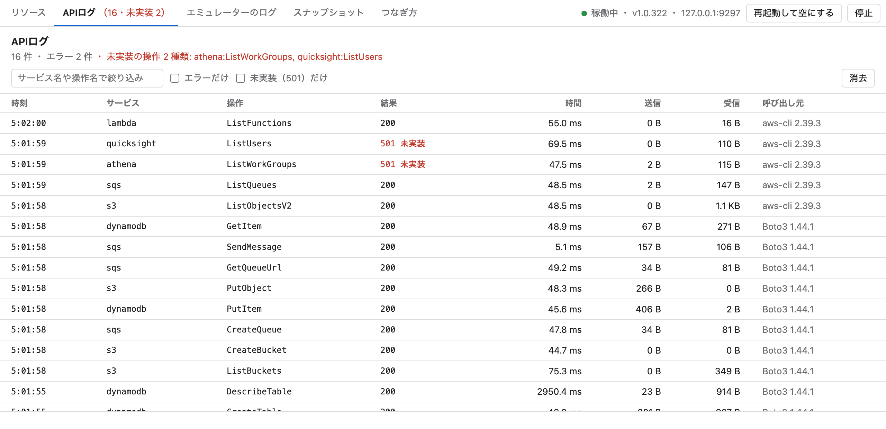
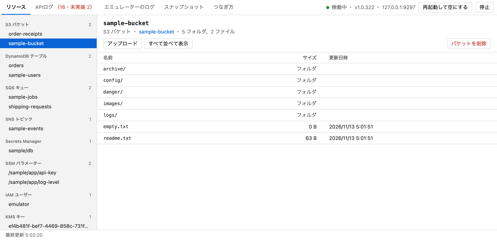
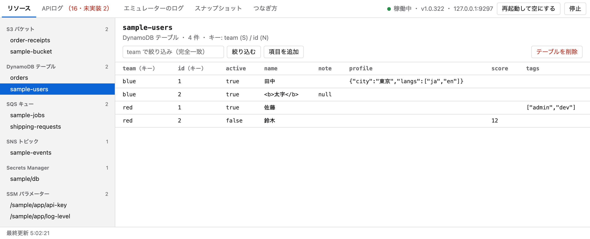

# emuscope

AWS公式のローカルエミュレーター「AWS Emulator」を使った開発を、やりやすくする道具。

AWS Emulator には画面がなく、止めると中身が全部消える。未実装のAPIは呼んでみるまでわからない。emuscope はそこを埋める。

- 中身をブラウザで見て、その場で書き換えられる
- アプリが投げた呼び出しを一覧にして、未実装（501）の操作を見つけられる
- 中身をフォルダに保存して、いつでも戻せる
- 環境変数を覚えなくても、コマンド1つでエミュレーターに向けられる
- テストを回すだけで、そのアプリが使うAPIのうち未実装のものを表にできる（CIでも使える）

AWS公式のツールではない。個人の実験で、対応は約束しない。



動作を確かめた環境: AWS Emulator 1.0.385（1.0.322 でも確認済み） / macOS 26.6（Apple Silicon）/ OrbStack / Python 3.15 / Boto3 1.44.1 / AWS CLI 2.39.3

## はじめかた

必要なもの: Docker（OrbStack でよい）と Python 3。

```bash
./emu dev
```

これで、エミュレーターの起動と画面の起動をまとめて行う。初回だけ、イメージのビルド（2分ほど）と Boto3 の導入が走る。画面は http://127.0.0.1:9298 。

サンプルデータを入れるには、別のターミナルで次を実行する。

```bash
./emu seed
```

## 画面

| 画面 | できること |
| --- | --- |
| リソース | 21種類のリソースを一覧する。S3・DynamoDB・SQS は中身の閲覧と書き込み、それ以外は一覧と詳細 |
| APIログ | アプリが投げた呼び出しを1件ずつ、または操作ごとにまとめて表示する。未実装の操作は赤で出る。対応状況レポートとして保存できる |
| エミュレーターのログ | エミュレーター自身の警告や監査ログを読む |
| スナップショット | 今の中身を保存する。保存した状態に戻す |
| つなぎ方 | 自分のプログラムからつなぐためのコマンドや環境変数を、コピーできる形で出す |

上の帯には、エミュレーターの状態と、再起動（空にする）・停止・起動のボタンがある。

### リソース



| 種類 | できること |
| --- | --- |
| S3 | フォルダごとの表示、テキスト・JSON・画像のプレビュー、アップロード（ドラッグも可）、ダウンロード、削除、バケットの作成と削除 |
| DynamoDB | 項目の表、パーティションキーでの絞り込み、続きの読み込み、項目の追加・編集・削除、テーブルの削除 |
| SQS | 待機中のメッセージの閲覧、送信、空にする、キューの削除 |
| ほか18種類 | 一覧と詳細。SNS、Lambda、Secrets Manager、SSM パラメーター、CloudWatch Logs、Kinesis、EventBridge、Step Functions、CloudFormation、API Gateway、IAM、KMS、ECR、Cognito、SES、EventBridge Scheduler |

3秒ごとに自動で更新する。入力中やダイアログ表示中は更新を止める。



DynamoDB の編集は、型付きJSON（`{"S": "文字"}` の形）で行う。数値や集合の型を取り違えないため。

SQS の中身だけは自動更新しない。SQS には「のぞくだけ」の方法がなく、読むたびに各メッセージの受信回数が1増えるため。

### APIログ

アプリとエミュレーターの間に中継サーバーを挟み、通った呼び出しを記録する。

```bash
./emu run --log -- python my_script.py
```

1件ごとに、サービス名、操作名、結果、かかった時間、呼び出し元（SDKの種類）が出る。行を押すと、要求と応答のヘッダーと本文を読める。

使いどころは、アプリを一通り動かしてから「未実装（501）だけ」に絞ること。そのアプリが使っているAPIのうち、エミュレーターで動かないものが一覧になる。「操作ごと」に切り替えると、同じ操作をまとめた表になる。「レポートを保存」で、その表を Markdown か JSON で保存できる。

中継は HTTP（`http://127.0.0.1:9299`）なので、証明書の設定が要らない。署名の値そのものは記録しない。本文はメモリに溜めずに流し、画面で読めるのは先頭 64KB まで。

### 対応状況レポート

画面を開かずに、同じことをコマンド1つで行う。テストを一通り回して、使った操作のうち未実装のものを表にする。

```bash
./emu record -- python -m unittest          # 実行して、終わったら表を出す
./emu record --out compat.md -- npm test    # ファイルに書く（拡張子が .json なら JSON）
./emu record --strict -- pytest             # 未実装が1つでもあれば終了コード 3
./emu report                                # 動いている画面（./emu ui）のAPIログから作る
./emu report --compare old.json             # 前に書き出した JSON と比べる
```

`./emu record` は自分で中継を立てるので、`./emu ui` は要らない。表は標準エラーに出す（テストの出力と混ざらないように）。終了コードは、コマンドが失敗すればその値、`--strict` で未実装があれば 3、それ以外は 0。

結果は操作ごとに3つに分ける。

| 結果 | 条件 |
| --- | --- |
| 未実装 | 501 が1回でもあった |
| 失敗だけ | 成功（400未満）が1回もなかった |
| 動いた | それ以外。4xx が混じっていてもよい（条件付き書き込みの失敗のように、テストがわざと起こすエラーが多いため） |

エミュレーターを新しくしたときは、前の JSON と比べると「実装された」「動かなくなった」操作がわかる。

```bash
./emu record --out before.json -- python -m unittest
# （ここでエミュレーターを新しくする）
./emu record --compare before.json -- python -m unittest
```

### スナップショット

```bash
./emu snapshot save base     # 今の状態を保存
./emu snapshot load base     # 空にしてから戻す
./emu up --load base         # 起動して、すぐ戻す
./emu down --save base       # 保存してから止める
```

保存するのは S3、DynamoDB（インデックスの定義を含む）、SQS（メッセージを含む）、SNS、SSM パラメーター、Secrets Manager。Lambda や CloudFormation などは保存しない。

保存先は `snapshots/<名前>/`。中身はただのファイルなので、Git で管理してテスト用のデータとして共有できる。シークレットの値も平文で入るので、本物の値は入れないこと。

## コマンド

| コマンド | すること |
| --- | --- |
| `./emu dev` | エミュレーターと画面をまとめて起動する |
| `./emu up` / `down` / `restart` | 起動・停止・再起動。再起動で中身は空になる |
| `./emu status` | 動いているか、バージョン、メモリ |
| `./emu doctor` | うまく動かないときに、どこで止まっているかを点検する |
| `./emu ui` | 画面と中継だけを起動する。`--read-only` で書き込みと再起動を禁止できる |
| `./emu run -- <コマンド>` | エミュレーターに向けてコマンドを実行する。止まっていれば起動する |
| `./emu run --log -- <コマンド>` | 同じ。呼び出しをAPIログに記録する |
| `./emu record -- <コマンド>` | 実行して、使ったAPIの対応状況を表にする。`--out` `--strict` `--compare` |
| `./emu report` | 画面のAPIログから、同じ表を作る |
| `./emu aws <...>` | `./emu run -- aws <...>` の短縮形 |
| `./emu env` | 環境変数を表示する。`eval "$(./emu env)"` で今のシェルを切り替える |
| `./emu seed` | サンプルデータを入れる |
| `./emu snapshot save\|load\|list\|delete` | 中身の保存と復元 |
| `./emu logs` | エミュレーター自身のログ |

`./emu` はどのフォルダからでも呼べる。`make dev` `make up` `make test` など、同じことをする Makefile もある。

ポートは環境変数で変えられる: `EMU_PORT`（既定 9297）、`EMU_UI_PORT`（9298）、`EMU_PROXY_PORT`（9299）。

場所も環境変数で変えられる。

| 環境変数 | 中身 | クローンして使うとき | pip で入れたとき |
| --- | --- | --- | --- |
| `EMU_HOME` | エミュレーターの鍵と証明書 | このフォルダの `.emu-home/` | `~/.emuscope/home` |
| `EMU_SNAPSHOTS` | スナップショット | このフォルダの `snapshots/` | 今いるフォルダの `snapshots/` |

## テストで使う

`emuscope.testing` を使うと、テストの前にエミュレーターを起動して、SDK の接続先を切り替える。

```python
from emuscope.testing import EmulatorTestCase


class OrderTest(EmulatorTestCase):
    clean_start = True          # 空の状態から始める
    # snapshot = "base"         # または、保存した状態から始める

    def test_bucket(self):
        s3 = self.client("s3")
        s3.create_bucket(Bucket="demo")
```

```bash
./emu run -- python -m unittest
```

`record = True` を付けると、そのプロセスの中で呼び出しを集計する。`emuscope.testing.unimplemented_calls()` で、未実装だった操作を読める。

### pytest

フィクスチャとオプションがある。pip で入れた場合は自動で読み込まれる。クローンして使う場合は、`conftest.py` に1行書く。

```python
# conftest.py（クローンして使う場合だけ）
pytest_plugins = ["emuscope.pytest_plugin"]
```

```python
import pytest


def test_bucket(emu_client):
    emu_client("s3").create_bucket(Bucket="demo")


@pytest.mark.emu_snapshot("base")     # このテストの前に、保存した状態に戻す
def test_from_saved_state(emu_client):
    ...


def test_from_empty(emu_reset, emu_client):   # 空の状態から始める
    ...
```

```bash
./emu run -- pytest --emu-strict --emu-report compat.md
```

| 名前 | すること |
| --- | --- |
| `emulator` | セッションの最初に一度、SDK をエミュレーターに向ける |
| `emu_client` | `boto3.client` を作る関数 |
| `emu_reset` | エミュレーターを再起動して、空の状態から始める |
| `--emu-report PATH` | 終わったら対応状況レポートを書く |
| `--emu-strict` | 未実装の操作を呼んでいたら、テストが全部通っても失敗にする（終了コード 3） |

動くサンプルが `examples/` にある。`orders.py` は DynamoDB・S3・SQS を使う小さな注文アプリで、コードにはエンドポイントも鍵も書いていない。`test_orders.py` がそのテスト。

```bash
make example
```

## 自分のプロジェクトに入れる

emuscope をクローンせず、自分のプロジェクトの venv に入れて使うこともできる。PyPI には出していない。

```bash
pip install git+https://github.com/akicraft/emuscope
emu up
emu record --strict -- pytest
```

このときは `./emu` の代わりに `emu` を使う。スナップショットはそのプロジェクトの `snapshots/` に入るので、プロジェクトの Git で管理できる。鍵と証明書は `~/.emuscope/home` に置く（エミュレーターはポートごとに1つなので、どのフォルダから呼んでも同じものを見る）。

別の場所の設定で起動したエミュレーターが残っていると、`emu up` がその旨を出して止まる。`emu down` してから起動し直す。

## 安全のために入れてあるもの

| 対策 | 理由 |
| --- | --- |
| 接続先・鍵・証明書をすべて明示して渡し、シェルの環境変数は見ない | `AWS_PROFILE` などが残っていても、本物のAWSに向かないようにするため |
| アカウントが `000000000000` でなければ、何も読み書きしない | 相手がエミュレーターであることを確かめるため |
| `./emu run` と `./emu env` は、本物向けの変数（`AWS_ACCESS_KEY_ID` など）を外す | エミュレーターの設定より優先されてしまうのを防ぐため |
| エミュレーターも画面も中継も、`127.0.0.1` だけで待ち受ける | 同じLANの他の機器から届かないようにするため |
| Host ヘッダーが `127.0.0.1` か `localhost` のリクエストだけ受ける | 別のサイトが名前を偽って読みに来る攻撃（DNSリバインディング）を防ぐため |
| 書き込みには、起動ごとに変わる合言葉を要求する | 別のサイトから勝手に削除や再起動をさせる攻撃（CSRF）を防ぐため |
| S3 などの中身は必ず文字として画面に入れる。画像として返すのは PNG・JPEG・GIF・WebP だけ | HTML や SVG に入ったスクリプトを実行させないため |
| 外部のスクリプトや通信を禁じるヘッダー（CSP）を付ける | 上の対策に漏れがあったときの保険 |
| テレメトリーは常にOFFで起動する | 利用状況を外に送らないため |

本物の `~/.aws` には触れない。エミュレーターの鍵や証明書は、このフォルダの `.emu-home/` に書かれる。

## 確かめていないこと

- JavaScript、Go、Java など、Boto3 と AWS CLI 以外のSDKからの接続（`./emu env` は Node 向けの `NODE_EXTRA_CA_CERTS` も出すが、試していない）
- Terraform や CDK からの利用
- 実物のエミュレーターを相手にした、中継を通す数百MBのファイルの送受信（中継は本文を流すようになり、偽の相手での 50MB の往復では、メモリが増えないことを確かめた）
- Intel の Mac と Linux での動作（x86_64 の RPM を選ぶ処理と、Linux でホストと同じユーザーで動かす処理は入れてあるが、試していない）
- `pip install` で入れた emuscope から、エミュレーターを起動すること
- 中継を通した、ストリーミング系のAPI（Kinesis の SubscribeToShard など）
- macOS 以外での動作
- 画面のファイル選択ダイアログと、実際のマウスでのドラッグ（アップロードの処理そのものは確認済み）

## エミュレーターについてわかったこと

作りながら確かめた、AWS Emulator 1.0.322 の挙動。1.0.385 で変わったと確かめた点は、その項目に書いてある。

- エンドポイントは HTTPS で、証明書は自己署名。鍵と証明書は起動のたびに変わる
- 署名は本物と同じように検証される。壊すと `InvalidSignatureException` になる
- 未実装のAPIは HTTP 501 `NotImplemented` を返す。AWS CLI も Boto3 も再試行しない
- 試した範囲で未実装だったのは Athena、QuickSight、Cost Explorer の一覧取得。1.0.385 では Athena の一覧取得（ListWorkGroups）が実装され、残りの2つはまだ未実装
- Lambda は実行（invoke）まで通った。作った直後の2秒ほどは状態が `Pending` で、その間は `ResourceConflictException` になる。本物と同じ挙動
- Step Functions は実行まで通った。CloudFormation のスタックから、S3 バケットと SQS キューが実際に作られた
- S3 は1バケットに1000個までしか置けない（本物にはない制限）
- SNS から SQS への配信は、キューのポリシーで許可していないと届かない。理由はエミュレーターのログに警告として出る
- 状態を変える操作は、エミュレーターのログに監査ログとして残る
- 起動は1秒ほど、メモリは200MiB前後

最初に手作業で試したときの記録は [docs/trial-log.md](docs/trial-log.md) にある。

## ファイル

| 場所 | 中身 |
| --- | --- |
| `emu` | 入口のシェルスクリプト。初回だけ `.venv` を作る |
| `emuscope/__main__.py` | コマンドの定義 |
| `emuscope/config.py` | 場所とポート、環境変数 |
| `emuscope/docker.py` | コンテナの起動と停止 |
| `emuscope/aws.py` | エミュレーターへの接続と、相手の確認 |
| `emuscope/catalog.py` | 21種類のリソースの「一覧」と「詳細」 |
| `emuscope/resources.py` | S3・DynamoDB・SQS の読み書き |
| `emuscope/proxy.py` | APIログ用の中継と、操作ごとの集計 |
| `emuscope/report.py` | 対応状況レポート |
| `emuscope/snapshot.py` | 保存と復元 |
| `emuscope/server.py` | 画面と、画面が呼ぶAPI |
| `emuscope/static/` | 画面の HTML・CSS・JavaScript |
| `emuscope/testing.py` | テスト用の補助 |
| `emuscope/pytest_plugin.py` | pytest のフィクスチャとオプション |
| `emuscope/image/Dockerfile` | AWSのドキュメントにあるものを、CPU に合わせて RPM を選べるようにしたもの |
| `emuscope/seed.py` | サンプルデータ |
| `tests/` | emuscope 自体のテスト（`make test`。エミュレーターの中身は消える）。`make test-offline` はエミュレーターなしで走る分だけ |
| `examples/` | サンプルのアプリとそのテスト |
| `pyproject.toml` | `pip install` 用の設定 |

依存は Boto3 だけ（pytest のプラグインは、pytest があるときだけ使う）。画面は外部のライブラリを使っていない。

対応するリソースの種類を足すときは、`emuscope/catalog.py` に「一覧を返す関数」と「詳細を返す関数」を書いて、`KINDS` に1行足す。

## ライセンス

MIT。[LICENSE](LICENSE) を参照。

`emuscope/image/Dockerfile` は、AWS のユーザーガイドに載っているものを2行変えたもの（AWS のサイト規約では、ドキュメント内のコードは MIT-0）。AWS Emulator 本体はこのリポジトリに含まれず、ビルド時に AWS から取得される。

## 参考

- [AWS Emulator ユーザーガイド](https://docs.aws.amazon.com/emulator/latest/userguide/getting-started-docker.html)
- [aws/aws-emulator](https://github.com/aws/aws-emulator)
